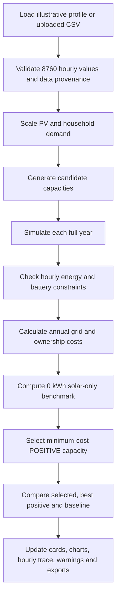

# Battery Sizing Studio — Complete Web Application Rebuild Guide

**Document type:** Developer handover, mathematical specification, implementation plan and test guide  
**Version:** 1.0 — 13 October 2026  
**Target:** Rebuild the latest interactive *Battery Sizing Studio* as a maintainable web application from scratch  
**Reference implementation:** `Battery_Sizing_Interactive_Web_No_Zero_Battery.html`  
**Research basis:** *Thesis Report A new (1)(1).docx*, the updated battery-sizing flowchart and the revised mathematical-model report  
**Audience:** Developer, research assistant, engineering student, software team, or AI coding assistant

> **Critical research disclosure:** The existing website contains a **synthetic, illustrative 8,760-hour dataset**, reconstructed to match five annual figures reported in the thesis. The hourly series are **not** the original measured thesis dataset. Reported battery-size optima derived from that dataset are examples, **not independently validated research findings**. The new system must label the origin of its data and assumptions in the UI, charts, CSV exports and reports.

---

## Table of contents

1. [Goal and design principles](#1-goal-and-design-principles)
2. [Exactly what the existing website does](#2-exactly-what-the-existing-website-does)
3. [Technology and project setup](#3-technology-and-project-setup)
4. [Required screens and interface](#4-required-screens-and-interface)
5. [All input parameters and defaults](#5-all-input-parameters-and-defaults)
6. [Mathematical definitions and equations](#6-mathematical-definitions-and-equations)
7. [Complete cost function and optimisation](#7-complete-cost-function-and-optimisation)
8. [Reference TypeScript simulation engine](#8-reference-typescript-simulation-engine)
9. [CSV schema, upload and export](#9-csv-schema-upload-and-export)
10. [UI state, interaction and chart logic](#10-ui-state-interaction-and-chart-logic)
11. [Expected default results (regression fixture)](#11-expected-default-results-regression-fixture)
12. [Validation, error messages and automated tests](#12-validation-error-messages-and-automated-tests)
13. [Implementation sequence](#13-implementation-sequence)
14. [Deployment and operations](#14-deployment-and-operations)
15. [Research limitations and future improvements](#15-research-limitations-and-future-improvements)
16. [Definition of done](#16-definition-of-done)
17. [Copy-paste handover prompt for a coding assistant](#17-copy-paste-handover-prompt-for-a-coding-assistant)
18. [References and provenance](#18-references-and-provenance)

---

## 1. Goal and design principles

### 1.1 The task

Create a responsive educational **battery-sizing web application** for an Australian residential home with rooftop PV and optional battery storage. The visitor changes PV, demand, battery, electrical, tariff and finance inputs; the program simulates **8,760 chronological hourly intervals** for each candidate battery capacity; it selects the **lowest-cost positive battery**; and it explains its decision with interactive charts, individual hourly calculations and checks.

The output is **a mathematical model and decision aid**, not an installer quotation, product recommendation, electric-system design, or guarantee of savings.

### 1.2 Important behavior: 0 kWh is NOT a battery

This was explicitly corrected in the latest website and must stay fixed:

- `0 kWh` is evaluated solely as the **solar-only reference**.
- The selectable battery slider starts at **0.5 kWh**, not 0.
- Only capacities **greater than 0** are eligible for the *Lowest-cost battery* recommendation.
- By default, positive capacities are tested at `0.5, 1.0, 1.5, ... 20.0 kWh` (40 choices).
- Keep the separate `0 kWh` reference to calculate whether investing in *any* battery makes financial sense.
- If the lowest-cost positive battery is **more expensive** than the solar-only reference, **do not suppress that fact**. Display both the requested positive-capacity recommendation and a prominent **financial warning**.
- Never label a capacity with `0 kWh` as an installable battery, even in charts or CSV files.

**Example wording:**

> **Lowest-cost eligible battery: 7.5 kWh.** However, it costs **A$12.07/year more than solar-only** under the current illustrative assumptions. This is an economic result, **not a calculation error**.

### 1.3 Required engineering principles

1. **Keep the physical simulation separate from React/UI code.** The same core functions must work in automated tests or on a server.
2. **Use explicit units**, especially the difference between battery **energy** (kWh), battery **power** (kW) and **SOC** (%).
3. **Always compare every candidate against the same hourly inputs** and tariff parameters.
4. **Handle solar-only explicitly**, without `SOC = storedEnergy / 0`.
5. **Prohibit out-of-range stored energy** and enforce charging/discharging power.
6. **Use a cyclic-year starting condition**, or an equivalent documented warm-up and terminal SOC policy, so initial stored energy does not produce fictitious savings.
7. **Separate financial warnings from actual calculation/validation errors**.
8. **Keep raw double-precision values for all calculations**. Round only at display/export boundaries.
9. **Preserve the data-source disclaimer** for synthetic hourly profiles.
10. **Treat the candidate battery sizes as numerical test options**, not necessarily commercially available models.

---

## 2. Exactly what the existing website does

The uploaded final standalone HTML contains the following behavior. This is the **reproduction specification**; later sections recommend a more maintainable implementation.

| Feature | Required behavior |
|---|---|
| App title | `Battery Sizing Studio — Explained Optimal Battery Size` |
| Simulation data | A full, chronological `8760`-hour PV and load profile |
| Default data | Bundled **illustrative reconstruction** matching thesis annual totals |
| Data modes | Illustration; user-uploaded CSV |
| Data input scaling | PV adjusted by `selectedPVkW / referencePVkW`; household load by demand multiplier |
| Battery selection | Positive capacities `0.5...20 kWh` in `0.5 kWh` steps |
| Baseline | Additional **0 kWh solar-only** reference, not selectable |
| Dispatch | Use solar for load first; charge on surplus; discharge on deficit; import/export remainder |
| Battery power | C-rate multiplied by nominal battery capacity |
| SOC | Minimum and maximum allowable bounds; separately track stored kWh |
| Starting SOC | Cyclic-year warm-up, seeking end-of-year stored energy equal to start-of-year |
| Tariffs | Flat import and export tariffs by default (AUD/kWh) |
| Costs | Fixed capex + per-kWh capex; illustrative gross-cost discount; CRF; annual O&M |
| Optimisation | Minimum equivalent annual total cost **among positive tested battery sizes** |
| Results | Selected, best positive, baseline, annual costs, cost gap, net benefit |
| Battery chart | Selected size highlighted **gold**, best positive **dark**, baseline **grey** |
| Comparison | Accessible, clickable capacity table, including the baseline row |
| Hourly display | Summer/autumn/winter/spring sample dates and any day 1–365, hour 0–23 |
| Hour trace | Explicit 8-step explanation of that hour's formula |
| Actions | Reset, presets, examine recommended, previous/next hour, play/pause, CSV upload, CSV export |
| Quality badges | Physical checks PASS/REVIEW, economic warning, input error (separate statuses) |
| Reference outputs | Annual baseline totals from thesis and illustrative battery results |

### 2.1 Presets

- **Report example:** all defaults listed in Section 5.
- **High retail price:** import tariff `0.65 AUD/kWh`, FiT `0.03 AUD/kWh`; other fields default.
- **Cheaper battery:** variable installed cost `300 AUD/kWh`, fixed cost `400 AUD`, hypothetical discount `50%`; other fields default.
- **Custom inputs:** automatically selected after any manual slider edit.
- **Reset:** reset all sliders and reference rating, not user-uploaded data unless explicitly asked. Provide an independent **Use illustration again** action to replace an uploaded profile with the sample.

### 2.2 The conceptual data flow



---

## 3. Technology and project setup

### 3.1 Recommended stack

For a clean rebuild, use **React + TypeScript + Vite**, **Recharts** for charts, **Papa Parse** for CSVs, and **Vitest** for mathematical unit tests. A responsive, offline-capable, client-only application is sufficient for the current dataset size; no database or API is required.

Optional: Tailwind CSS, Zod for validating input forms, Playwright for browser/E2E tests, and a Web Worker for larger simulation runs. No cloud service, authentication or backend is necessary for the core tool.

### 3.2 Create the project

```bash
npm create vite@latest battery-sizing-studio -- --template react-ts
cd battery-sizing-studio
npm install
npm install recharts papaparse lucide-react
npm install -D vitest @types/papaparse @testing-library/react @testing-library/jest-dom jsdom
npm run dev
```

For Node.js, use the currently supported stable/LTS release and follow Vite's current compatibility guidance. The precise Vite version will change with time; do **not** hard-code an old runtime version into the scientific equations.

Add to `package.json` scripts:

```json
{
  "scripts": {
    "dev": "vite",
    "build": "tsc -b && vite build",
    "preview": "vite preview",
    "test": "vitest run",
    "test:watch": "vitest"
  }
}
```

### 3.3 Suggested folder structure

```text
battery-sizing-studio/
├── public/
│   └── examples/
│       └── example_8760_hours_illustrative.csv
├── src/
│   ├── app/
│   │   ├── App.tsx
│   │   └── presets.ts
│   ├── components/
│   │   ├── ParametersPanel.tsx
│   │   ├── ResultsSummary.tsx
│   │   ├── RecommendationCard.tsx
│   │   ├── FinancialWarnings.tsx
│   │   ├── CostBenefitChart.tsx
│   │   ├── CapacityComparisonTable.tsx
│   │   ├── HourlyExplorer.tsx
│   │   ├── EnergyFlowDiagram.tsx
│   │   ├── AnnualAccounting.tsx
│   │   ├── CSVUpload.tsx
│   │   └── FormulaExplainer.tsx
│   ├── engine/
│   │   ├── model.ts              # pure calculations
│   │   ├── types.ts
│   │   ├── validation.ts
│   │   ├── csv.ts
│   │   ├── metrics.ts
│   │   └── model.test.ts
│   ├── data/
│   │   └── loadExample.ts
│   ├── styles/
│   │   └── app.css
│   └── main.tsx
├── README.md
├── package.json
├── tsconfig.json
└── vite.config.ts
```

**Never paste a 200 KB hard-coded data array into the main UI file.** Instead, store illustrative data in a labeled CSV under `public/examples` and fetch it locally when the app starts. This reproduces the output but keeps the source maintainable.

---

## 4. Required screens and interface

The website should be a **single responsive page** with a readable explanation, prominent results and expandable mathematical details.

### 4.1 Page layout

**Desktop:** a sticky or persistent sidebar containing the input sliders and data upload controls, with the main analytical content alongside. **Mobile:** a full-width, collapsed/accordion parameter section followed by readable cards and charts. Never let charts overflow horizontally without an accessible scroll/zoom method.

Main content order:

1. **Introduction:** “How the battery-sizing function actually works”, clear data provenance.
2. **Mathematical decision function:** present objective, cost components and operating conditions.
3. **Recommendation banner:** lowest-cost eligible **positive** battery, strong savings-or-warning explanation.
4. **Selected vs best positive vs solar-only results:** four key metrics and precise cost gap.
5. **Net annual benefit chart:** gold selected marker, dark best-positive marker, grey baseline; explicit legend.
6. **Capacity comparison table:** include 0 kWh as a grey, noninteractive reference row; selected positive row highlighted.
7. **Hourly explorer:** select day/hour; PV and load graph; energy-flow diagram; stored energy and SOC.
8. **Eight-stage formula trace:** show actual numeric values substituted into each equation.
9. **Annual energy accounting:** PV generation, demand, direct solar use, charging/discharging, imports/exports, self-consumption, self-sufficiency, cycles.
10. **Capital and cost breakdown:** gross/net capex, discount, CRF, O&M, grid purchases, FiT revenue, total cost.
11. **Validation and model limitations:** energy check, SOC check, cyclic check, warnings, source disclosure.
12. **References and methods:** mathematical explanation, source attribution, explicit future-work scope.

### 4.2 Required visual semantics

| Visual/state | Meaning |
|---|---|
| **Gold/amber** | User-selected positive battery capacity |
| **Dark navy** | Cheapest positive battery across candidates |
| **Grey** | Solar-only reference, `0 kWh`, not a battery |
| **Green** | Valid calculation and/or financially beneficial result |
| **Amber warning** | Valid but economically less attractive than another option or than the baseline |
| **Red error** | Invalid input, corrupt CSV, non-finite calculation, failed physical check |

**Accessibility:** never rely only on color: add labels `SELECTED`, `BEST BATTERY`, `SOLAR ONLY`, and visible text such as `EXTRA A$51.70/YEAR`. Charts must have tooltips, text alternatives, and keyboard-selectable rows/points.

### 4.3 Calculation-result status rules

Let `baseline`, `bestPositive`, `selected` be computed model outputs. Define:

```text
selected_vs_best_gap = selected.totalCost - bestPositive.totalCost
selected_vs_baseline_benefit = baseline.totalCost - selected.totalCost
best_vs_baseline_benefit = baseline.totalCost - bestPositive.totalCost
```

- If `best_vs_baseline_benefit < -0.005`, show: **FINANCIAL WARNING: No tested battery beats solar-only**. Still display `bestPositive.capacity` as the lowest-cost *eligible battery*.
- If `selected_vs_best_gap > 0.005`, show: **Selected battery costs A$X/year more than the best eligible battery**.
- If `selected_vs_best_gap <= 0.005`, show: **Selected battery is the lowest-cost eligible battery**.
- If checks fail or a CSV is invalid, show **CALCULATION ERROR**, not a financial warning; do not claim a valid optimum.
- Use a display rounding tolerance of half a cent for summary labels; use tighter numerical tolerances for physical equations.

---

## 5. All input parameters and defaults

These reflect the actual sliders in the uploaded final HTML, **not automatically recommended engineering values**.

| UI label / ID | Default | Allowed UI range | Units | Role |
|---|---:|---:|---|---|
| `battery` — Battery examined | 10 | 0.5–20; step 0.5 | kWh | Currently selected positive battery for detailed charts |
| `pvsize` — Rooftop PV rating | 6.6 | 3–12; step 0.1 | kW | Scales the PV time series |
| `demand` — Demand multiplier | 1.00 | 0.5–1.75; step 0.05 | × | Scales load at every hour |
| `importtariff` — Retail import tariff | 0.35 | 0.10–0.85; step 0.01 | AUD/kWh | Financial value of electricity imported/avoided |
| `fit` — Feed-in tariff | 0.05 | 0–0.25; step 0.01 | AUD/kWh | Revenue/opportunity cost for exported PV |
| `variable` — Battery installed cost | 700 | 100–1400; step 25 | AUD/kWh | Variable initial capex |
| `subsidy` — Hypothetical cost discount | 30 | 0–70; step 5 | % | Illustrative gross capex discount, **not a government policy implementation** |
| `eta` — Charge/discharge efficiency | 95 | 80–99; step 1 | % each way | Charge and discharge efficiency set equal in current UI |
| `crate` — Charge/discharge power | 0.50 | 0.1–1.5; step 0.05 | C | C-rate, same for charge and discharge in current UI |
| `socmin` — Minimum SOC | 10 | 0–35; step 5 | % | Lower allowed SOC |
| `socmax` — Maximum SOC | 95 | 65–100; step 5 | % | Upper allowed SOC; must exceed minimum |
| `discount` — Annual discount rate | 6 | 0–15; step 1 | %/year | CRF financial calculation |
| `life` — Economic lifetime | 10 | 5–20; step 1 | years | CRF horizon |
| `fixed` — Fixed installed cost | 1000 | 0–3000; step 100 | AUD | Initial fixed capex only if capacity > 0 |
| `om` — Annual O&M | 1.00 | 0–4; step 0.25 | % of gross capex/year | Annual owner cost |
| `refsize` — CSV reference PV size | 6.6 | positive, numeric | kW | Rating associated with source PV series |

**Additional data state:** `sourcePV[8760]`, `sourceLoad[8760]`, source type (`illustration` or `uploaded`), filename, `referencePVkW`, calendar year (`2025` in the example), selected day index (`0...364`), and selected hour (`0...23`).

**For a future production-grade model:** separate `chargeEfficiency` from `dischargeEfficiency`, and `maxChargePowerKW` from `maxDischargePowerKW`. The old website combines each pair for ease of demonstration. Also allow actual commercially available battery candidates instead of assuming every 0.5 kWh option exists.

---

## 6. Mathematical definitions and equations

### 6.1 Units and symbols

| Symbol | Meaning | Unit |
|---|---|---|
| `t` | Hourly timestep; `0 ... 8759` in code | integer |
| `Δt` | Time interval, default `1` | hour |
| `E_PV,t` | PV energy generated within timestep | kWh |
| `E_L,t` | Household electricity used within timestep | kWh |
| `E_b` | Nominal battery capacity | kWh |
| `S_t` | Excess PV after serving the household | kWh |
| `D_t` | Remaining household energy deficit | kWh |
| `B_t` | Energy stored at the **end** of timestep | kWh |
| `B_(t-1)` | Energy stored at the **start** of timestep | kWh |
| `E_ch,t` | Energy sent into charging system from PV | kWh |
| `E_dis,t` | Energy delivered **from battery to AC load** | kWh |
| `η_c`, `η_d` | Charging, discharging efficiency, between 0 and 1 | dimensionless |
| `SOC_min`, `SOC_max` | Allowed bounds, between 0 and 1 inside engine | fraction |
| `P_ch,max`, `P_dis,max` | Maximum charge/discharge power | kW |
| `T_import,t`, `T_FIT,t` | Import and export prices | AUD/kWh |
| `C_grid` | Annual net grid bill (excluding fixed common charges) | AUD/year |
| `C_owner` | Equivalent annual battery ownership cost | AUD/year |
| `C_total` | Net grid bill plus owner cost | AUD/year |
| `C_0` | Solar-only annual cost | AUD/year |
| `NB(E_b)` | Net annual benefit vs solar-only | AUD/year |

### 6.2 PV and household demand

For a data file containing hourly PV generation at reference rating `P_ref`:

```text
PV[t]   = uploadedPV[t] * (selectedPVkW / referencePVkW)
Load[t] = uploadedLoad[t] * selectedDemandMultiplier
```

If generating PV from irradiation (optional future feature), a simple engineering approximation is:

```text
E_PV,t = P_PV,rated × (G_POA,t / G_STC) × PR_t × Δt
```

where `G_POA,t` is plane-of-array irradiance. **Do not apply the performance ratio a second time** when the uploaded CSV already contains electrical PV generation. The existing app uses a *PV time-series scaler*, not an online weather service.

### 6.3 Hourly surplus and deficit

```text
S_t = max(0, E_PV,t - E_L,t)
D_t = max(0, E_L,t - E_PV,t)
```

A single hour cannot have both `S_t > 0` and `D_t > 0`.

### 6.4 Charging/discharging power

Under the current C-rate model:

```text
P_ch,max(E_b)  = C_rate × E_b           [kW]
P_dis,max(E_b) = C_rate × E_b           [kW]
```

The allowed energy transfer over timestep `Δt` is `P_max × Δt` (kWh). **Do not confuse 0.5 C with 0.5 kWh**: a 10 kWh battery at 0.5 C has a 5 kW charge/discharge power limit.

### 6.5 Battery charging and discharging equations

For each positive battery `E_b`:

```text
B_min = SOC_min × E_b
B_max = SOC_max × E_b

E_ch,t = min(
    S_t,
    P_ch,max × Δt,
    (B_max - B_(t-1)) / η_c
)

E_dis,t = min(
    D_t,
    P_dis,max × Δt,
    (B_(t-1) - B_min) × η_d
)
```

Clamp tiny numerical negatives to zero if needed; never create negative charge or discharge. With the **PV-first rule**, charging happens only on PV surplus; discharging happens only on deficit. No grid charging, export from the battery, price arbitrage, curtailment decisions, or simultaneous charging/discharging are part of the current model.

### 6.6 Battery state update

```text
B_t = B_(t-1) + η_c × E_ch,t - E_dis,t / η_d

SOC_t_percent = (B_t / E_b) × 100               only when E_b > 0
```

Required constraints:

```text
B_min - ε <= B_t <= B_max + ε
0 <= E_ch,t <= S_t
0 <= E_dis,t <= D_t
E_ch,t <= P_ch,max × Δt
E_dis,t <= P_dis,max × Δt
```

For `E_b = 0`, do not calculate SOC: battery transfers and ownership cost are zero.

### 6.7 Grid import/export

```text
E_import,t = D_t - E_dis,t
E_export,t = S_t - E_ch,t
```

Both must remain nonnegative. Grid dispatch is the remainder after PV and battery.

### 6.8 Essential physical balance checks

At every hour:

```text
E_PV,t + E_import,t + E_dis,t
      = E_L,t + E_ch,t + E_export,t
```

Check:

```text
residual_t = abs(
    E_PV,t + E_import,t + E_dis,t
    - E_L,t - E_ch,t - E_export,t
)

maxHourlyResidual = max(residual_t)
```

Target for double-precision arithmetic: `maxHourlyResidual < 1e-7 kWh` (tolerances can be tightened after tests).

**Battery internal energy accounting** is separately described by `B_t - B_(t-1) = η_c E_ch,t - E_dis,t / η_d`. Conversion losses belong here; do not add a second loss to the AC/grid balance.

### 6.9 Initial condition and end-of-year SOC

**Why:** Starting every battery at 95% SOC gives free initial energy, biasing the results. The reference HTML instead attempts to find an initial stored energy that matches the final stored energy after a complete year.

**Reference method:**

1. Begin `B0 = B_min`.
2. Simulate one full 8,760-hour year from `B0` without recording the arrays; get `B_end`.
3. If `abs(B_end - B0) < 1e-9 kWh`, stop.
4. Otherwise set `B0 = B_end` and repeat (up to 50 annual warm-up passes).
5. Run the year again from the obtained `B0`, recording all hourly outputs.
6. **Independently verify** `abs(B_end - B0) < 1e-6 kWh`. If not, report nonconvergence and do **not** claim a valid cyclic battery result.

The total-to-year cost model assumes a representative repeating year. A more sophisticated alternative is to enforce `B_end = B0` in a constrained optimiser or use multiple years of distinct input data. **Never silently force the last SOC to equal the first after calculating flows**; that violates the physics.

---

## 7. Complete cost function and optimisation

### 7.1 Gross and net installation cost

For `E_b > 0`:

```text
C_gross(E_b) = C_fixed + C_variable_per_kWh × E_b
```

For solar-only `E_b = 0`, `C_gross(0) = 0`.

**Exact current illustrative web behavior:**

```text
S_illustrative(E_b) = C_gross(E_b) × (discountPercent / 100)
C_net(E_b)          = max(0, C_gross(E_b) - S_illustrative(E_b))
```

This is a **hypothetical percentage discount**. A real Australian battery scheme must have a dedicated, dated policy/eligibility function with its proper capacity basis, subsidy caps and other verified rules. Do not relabel the slider as a legally accurate government rebate.

### 7.2 Annualise capital with CRF

Let `r` be the *decimal* annual discount rate and `L` be years:

```text
CRF(r,L) = r(1+r)^L / [(1+r)^L - 1]     if r > 0
CRF(0,L) = 1/L

C_capital_annual(E_b) = C_net(E_b) × CRF(r,L)
C_O&M_annual(E_b)     = C_gross(E_b) × O&M_rate
C_owner(E_b)          = C_capital_annual(E_b) + C_O&M_annual(E_b)
```

Both owner terms are zero for `E_b = 0`. The baseline is never subsidised.

**Scope:** CRF is a simplified representative-year economic comparison. It does not model multiple replacement dates, degradation, annually changing prices or battery salvage value. Those require a multi-year cash-flow/NPV model.

### 7.3 Annual grid cost

Current flat-rate app:

```text
C_grid(E_b) = sum(E_import,t) × T_import - sum(E_export,t) × T_FIT
```

Extensible general form:

```text
C_grid(E_b) = Σ[t](E_import,t × T_import,t - E_export,t × T_FIT,t)
```

When `T_import,t` varies over time, the **physical dispatch policy must be reconsidered**: a fixed PV-first greedy strategy does not generally minimise expenditure under time-of-use tariffs. In a rebuild, keep a policy module (`selfConsumptionFirst`) and label it clearly; only advertise cost-optimal dispatch if a genuine dispatch optimiser is implemented.

Common fixed supply charges that are identical for all tested capacities may be excluded for **relative comparisons**. Include them for accurate absolute electricity bills.

### 7.4 Total equivalent annual cost

```text
C_total(E_b) = C_grid(E_b) + C_owner(E_b)
```

### 7.5 Two different decisions — keep both

**Battery-only recommendation (the website requirement):**

```text
E_best_positive = argmin C_total(E_b)
                  E_b ∈ {0.5, 1.0, ..., 20.0} kWh
```

**Whether to buy a battery at all (a separate economic decision):**

```text
C_0 = C_total(0)
NetBenefit(E_b) = C_0 - C_total(E_b)
```

If `NetBenefit(E_best_positive) < 0`, **no positive battery is cost-effective** relative to solar-only under the present assumptions, even though the UI still displays the best positive modelled capacity. This distinction is essential for research integrity.

**Selected battery comparison:**

```text
SelectedPremium = C_total(selected) - C_total(E_best_positive)
                  ≥ 0, within floating-point tolerance
```

### 7.6 Energy metrics (correct terminology)

Use **different denominators** for self-consumption and self-sufficiency:

```text
DirectPV = Σ[t] min(PV[t], Load[t])

PV self-consumption (%)
  = 100 × (DirectPV + totalBatteryChargeFromPV) / totalPVGeneration

Solar self-sufficiency / load coverage (%)
  = 100 × (DirectPV + totalBatteryDeliveredToLoad) / totalHouseholdDemand

Equivalent full cycles (approx.)
  = (totalACBatteryDischarge / η_d) / nominalBatteryCapacity
```

The self-consumption definition above counts PV electricity **absorbed for charging**, including conversion losses, as PV used on-site. If the thesis uses a narrower *useful-energy* definition, document and consistently implement it instead. Other possible KPIs: direct load coverage, grid reduction, export reduction, usable capacity and total battery discharge.

In the thesis's **solar-only** baseline:

- PV self-consumption = `2,668 / 10,539 × 100 = 25.3%`.
- Direct solar load coverage = `2,668 / 5,780 × 100 = 46.2%`.

These must **not** be labeled interchangeably. The current web UI's high-level `kpiSelf` is in fact a load-coverage/self-sufficiency calculation; rename it accordingly in the rebuild.

---
## 8. Reference TypeScript simulation engine

This section is **actual implementation-oriented code** for `src/engine/model.ts`. It reconstructs the physical and simplified financial functions without coupling them to the DOM. It intentionally keeps **0 kWh** for the baseline while restricting recommendations to **positive** capacities. For clarity, it uses the current website's paired efficiency, C-rate and flat tariff assumptions. A future model can extend these fields individually.

> **Implementation note:** This code is a rebuild reference derived from the latest HTML, not a verbatim copy of the minified/inlined source. Integrate it into the proposed Vite project, compile, run the unit tests, and compare its numerical outputs with Section 11 before deployment.

```ts
// src/engine/model.ts
export const HOURS = 8760;
export const EPS = 1e-9;

export type Inputs = {
  selectedBatteryKWh: number;
  pvKW: number;
  pvReferenceKW: number;
  demandMultiplier: number;
  importAUDPerKWh: number;
  feedInAUDPerKWh: number;
  variableCapexAUDPerKWh: number;
  fixedCapexAUD: number;
  hypotheticalDiscountPct: number;
  efficiencyPct: number;       // applied EACH way
  cRate: number;               // applied to charge and discharge
  socMinPct: number;
  socMaxPct: number;
  annualDiscountRatePct: number;
  lifeYears: number;
  annualOMPercentGross: number;
};

export type Series = {
  pv: Float64Array;
  load: Float64Array;
};

export type Hour = {
  index: number;
  pv: number;
  load: number;
  surplus: number;
  deficit: number;
  storedBefore: number;
  charge: number;
  discharge: number;
  storedAfter: number;
  gridImport: number;
  gridExport: number;
  socEndPct: number | null;
  energyResidual: number;
};

export type Result = {
  capacityKWh: number;
  initialKWh: number;
  finalKWh: number;
  cyclicResidual: number;
  maxEnergyResidual: number;
  minStoredKWh: number;
  maxStoredKWh: number;
  importKWh: number;
  exportKWh: number;
  chargedKWh: number;
  dischargedKWh: number;
  equivalentCycles: number;
  gridCostAUD: number;
  grossCapexAUD: number;
  subsidyAUD: number;
  netCapexAUD: number;
  annualCapitalAUD: number;
  annualOMAUD: number;
  ownerCostAUD: number;
  totalAnnualCostAUD: number;
  netBenefitAUD: number;
  hourly?: Hour[];
};

export function validateInputs(p: Inputs): void {
  for (const [key, value] of Object.entries(p)) {
    if (!Number.isFinite(value)) throw Error(`${key} must be a finite number`);
  }
  if (p.selectedBatteryKWh <= 0)
    throw Error("Select a real battery capacity greater than 0 kWh");
  if (p.pvKW <= 0 || p.pvReferenceKW <= 0 || p.demandMultiplier <= 0)
    throw Error("PV rating, reference PV rating and load multiplier must be positive");
  if (!(p.efficiencyPct > 0 && p.efficiencyPct <= 100))
    throw Error("Efficiency must be between 0 and 100 percent");
  if (p.cRate <= 0 || p.lifeYears <= 0)
    throw Error("C-rate and economic life must be positive");
  if (p.socMinPct < 0 || p.socMaxPct > 100 || p.socMinPct >= p.socMaxPct)
    throw Error("SOC minimum must be below SOC maximum, within 0–100%");
  if (p.importAUDPerKWh < 0 || p.feedInAUDPerKWh < 0)
    throw Error("Flat tariffs must be nonnegative");
  if (p.variableCapexAUDPerKWh < 0 || p.fixedCapexAUD < 0)
    throw Error("Battery installed cost cannot be negative");
  if (p.hypotheticalDiscountPct < 0 || p.hypotheticalDiscountPct > 100)
    throw Error("Hypothetical discount must be between 0 and 100%");
  if (p.annualDiscountRatePct < 0 || p.annualOMPercentGross < 0)
    throw Error("Discount rate and O&M rate cannot be negative");
}

export function scaleSeries(
  referencePV: readonly number[],
  referenceLoad: readonly number[],
  p: Inputs
): Series {
  if (referencePV.length !== HOURS || referenceLoad.length !== HOURS)
    throw Error(`Both input profiles must contain exactly ${HOURS} hours`);

  const pv = new Float64Array(HOURS);
  const load = new Float64Array(HOURS);
  const pvMultiplier = p.pvKW / p.pvReferenceKW;

  for (let t = 0; t < HOURS; t++) {
    const a = referencePV[t], b = referenceLoad[t];
    if (!Number.isFinite(a) || !Number.isFinite(b) || a < 0 || b < 0)
      throw Error(`Invalid PV or load energy at CSV hour ${t + 1}`);
    pv[t] = a * pvMultiplier;
    load[t] = b * p.demandMultiplier;
  }
  return { pv, load };
}

export function capitalRecoveryFactor(rate: number, years: number): number {
  if (rate < 0 || years <= 0) throw Error("Invalid CRF inputs");
  if (rate === 0) return 1 / years;
  const growth = (1 + rate) ** years;
  return rate * growth / (growth - 1);
}

type Pass = {
  endKWh: number;
  minKWh: number;
  maxKWh: number;
  importKWh: number;
  exportKWh: number;
  chargedKWh: number;
  dischargedKWh: number;
  maxResidual: number;
  hourly?: Hour[];
};

function runYearPass(
  capacityKWh: number, p: Inputs, series: Series,
  initialKWh: number, recordHours: boolean
): Pass {
  const efficiency = p.efficiencyPct / 100;
  const minimum = capacityKWh * p.socMinPct / 100;
  const maximum = capacityKWh * p.socMaxPct / 100;
  const transferLimitKWh = capacityKWh * p.cRate * 1; // Δt=1 hour

  let stored = initialKWh;
  let minObserved = stored, maxObserved = stored;
  let imported = 0, exported = 0, charged = 0, discharged = 0;
  let maxResidual = 0;
  const hourly: Hour[] | undefined = recordHours ? [] : undefined;

  for (let t = 0; t < HOURS; t++) {
    const pv = series.pv[t];
    const load = series.load[t];
    const surplus = Math.max(0, pv - load);
    const deficit = Math.max(0, load - pv);
    const storedBefore = stored;
    let charge = 0, discharge = 0;

    if (capacityKWh > 0) {
      if (surplus > 0) {
        const remainingRoom = Math.max(0, (maximum - stored) / efficiency);
        charge = Math.min(surplus, transferLimitKWh, remainingRoom);
      } else if (deficit > 0) {
        const availableOutput = Math.max(0, (stored - minimum) * efficiency);
        discharge = Math.min(deficit, transferLimitKWh, availableOutput);
      }
      stored = stored + efficiency * charge - discharge / efficiency;
    }

    const gridImport = deficit - discharge;
    const gridExport = surplus - charge;
    const residual = Math.abs(
      pv + gridImport + discharge - load - charge - gridExport
    );

    maxResidual = Math.max(maxResidual, residual);
    minObserved = Math.min(minObserved, stored);
    maxObserved = Math.max(maxObserved, stored);
    imported += gridImport; exported += gridExport;
    charged += charge; discharged += discharge;

    if (hourly) hourly.push({
      index: t, pv, load, surplus, deficit, storedBefore,
      charge, discharge, storedAfter: stored, gridImport, gridExport,
      socEndPct: capacityKWh > 0 ? 100 * stored / capacityKWh : null,
      energyResidual: residual
    });
  }

  return {
    endKWh: stored, minKWh: minObserved, maxKWh: maxObserved,
    importKWh: imported, exportKWh: exported,
    chargedKWh: charged, dischargedKWh: discharged,
    maxResidual, hourly
  };
}

export function simulateCapacity(
  capacityKWh: number, p: Inputs, series: Series,
  detailed = false
): Result {
  if (capacityKWh < 0 || !Number.isFinite(capacityKWh))
    throw Error("Battery capacity must be nonnegative and finite");

  const lower = capacityKWh * p.socMinPct / 100;
  const upper = capacityKWh * p.socMaxPct / 100;
  let start = lower;

  // Cyclic representative-year warm-up; bypass it for solar-only.
  if (capacityKWh > 0) {
    for (let k = 0; k < 50; k++) {
      const end = runYearPass(capacityKWh, p, series, start, false).endKWh;
      if (Math.abs(end - start) < 1e-9) { start = end; break; }
      start = end;
    }
  }

  const annual = runYearPass(capacityKWh, p, series, start, detailed);
  const cyclicResidual = Math.abs(annual.endKWh - start);

  if (annual.maxResidual > 1e-7)
    throw Error(`Hourly energy-balance failure at ${capacityKWh} kWh`);
  if (annual.minKWh < lower - 1e-7 || annual.maxKWh > upper + 1e-7)
    throw Error(`SOC constraint violation at ${capacityKWh} kWh`);
  if (cyclicResidual > 1e-6)
    throw Error(`Cyclic-year SOC did not converge at ${capacityKWh} kWh`);

  const gross = capacityKWh > 0
    ? p.fixedCapexAUD + capacityKWh * p.variableCapexAUDPerKWh
    : 0;
  const subsidy = gross * p.hypotheticalDiscountPct / 100;
  const net = Math.max(0, gross - subsidy);
  const annualCapital = net * capitalRecoveryFactor(
    p.annualDiscountRatePct / 100, p.lifeYears
  );
  const annualOM = gross * p.annualOMPercentGross / 100;
  const ownerCost = annualCapital + annualOM;
  const gridCost = annual.importKWh * p.importAUDPerKWh
    - annual.exportKWh * p.feedInAUDPerKWh;
  const totalCost = gridCost + ownerCost;

  return {
    capacityKWh,
    initialKWh: start, finalKWh: annual.endKWh,
    cyclicResidual, maxEnergyResidual: annual.maxResidual,
    minStoredKWh: annual.minKWh, maxStoredKWh: annual.maxKWh,
    importKWh: annual.importKWh,
    exportKWh: annual.exportKWh,
    chargedKWh: annual.chargedKWh,
    dischargedKWh: annual.dischargedKWh,
    equivalentCycles: capacityKWh > 0
      ? annual.dischargedKWh / (p.efficiencyPct / 100) / capacityKWh
      : 0,
    gridCostAUD: gridCost,
    grossCapexAUD: gross, subsidyAUD: subsidy, netCapexAUD: net,
    annualCapitalAUD: annualCapital,
    annualOMAUD: annualOM, ownerCostAUD: ownerCost,
    totalAnnualCostAUD: totalCost,
    netBenefitAUD: 0, // Filled using the solar-only baseline below.
    hourly: annual.hourly
  };
}

export function evaluateAll(
  inputs: Inputs, referencePV: readonly number[],
  referenceLoad: readonly number[]
) {
  validateInputs(inputs);
  const series = scaleSeries(referencePV, referenceLoad, inputs);
  const capacities = Array.from({ length: 41 }, (_, i) => i * 0.5);
  const results = capacities.map(e => simulateCapacity(e, inputs, series));
  const baseline = results[0];

  for (const result of results) {
    result.netBenefitAUD =
      baseline.totalAnnualCostAUD - result.totalAnnualCostAUD;
  }

  const eligible = results.filter(result => result.capacityKWh > 0);
  const bestPositive = eligible.reduce((best, candidate) =>
    candidate.totalAnnualCostAUD < best.totalAnnualCostAUD - EPS
      ? candidate : best
  );

  // Slider values are restricted to 0.5 kWh multiples.
  const selected = eligible.find(result =>
    Math.abs(result.capacityKWh - inputs.selectedBatteryKWh) < 1e-8
  );
  if (!selected) throw Error("Selected battery is outside the candidate set");

  const selectedDetail = simulateCapacity(
    selected.capacityKWh, inputs, series, true
  );
  selectedDetail.netBenefitAUD =
    baseline.totalAnnualCostAUD - selectedDetail.totalAnnualCostAUD;

  return {
    series, results, baseline, bestPositive,
    selected: selectedDetail,
    selectedPremiumAUD: selectedDetail.totalAnnualCostAUD
      - bestPositive.totalAnnualCostAUD,
    bestBatteryFinanciallyWorthwhile: bestPositive.netBenefitAUD >= -0.005,
    sourceNote: "Attach provenance of the input profile separately"
  };
}
```

### 8.1 Physical test-case walkthrough

An uncomplicated two-hour example is useful when debugging the code. Suppose: `E_b=10 kWh`, `SOC_min=10%`, `SOC_max=95%`, `η_c=η_d=95%`, `C-rate=0.5`, and the **start-of-hour stored energy** is `5 kWh`.

**Sunny hour:** `PV=5 kWh`, `load=2 kWh` → surplus `3 kWh`, deficit `0 kWh`, max allowed charging energy `5 kWh`. Available headroom before losses is `(9.5−5)/0.95 ≈ 4.7368 kWh`. So `charge=3 kWh`, `storedAfter=5+0.95×3=7.85 kWh`, `SOC=78.5%`, import/export `0`.

**Next dark hour:** `PV=0`, `load=4 kWh` → deficit `4 kWh`; available AC output before discharging is `(7.85−1)×0.95=6.5075 kWh`, power cap `5 kWh`; so `discharge=4 kWh`, `storedAfter=7.85−4/0.95≈3.63947 kWh`, `SOC≈36.39%`, import/export `0`.

**Important:** This is a component-level demonstration using a manually selected stored energy. It is **not** a two-hour simulation of the 8,760-hour cyclic initialisation function and should not be mixed with the annual regression fixture.

---

## 9. CSV schema, upload and export

### 9.1 Required file format

The existing website imports two hour-aligned series from a CSV:

```csv
pv_generation_kwh,household_load_kwh
0.000,0.264
0.000,0.295
0.000,0.300
...
```

Requirements:

- Exactly `8760` **data rows** for the present non-leap-year implementation, plus one header row.
- `pv_generation_kwh` and `household_load_kwh` must be present (case-insensitive names).
- Values must be **finite**, **nonnegative**, and interpreted as **kWh energy in that hour**.
- Rows must be **chronological**, and PV/load measurements must refer to the **same** intervals and timezone.
- The dataset must represent a **non-leap year** or already be transformed into a documented 8,760-hour calendar.
- The UI separately asks for `referencePVkW`, the installed PV rating behind the uploaded PV values.
- Preserve data origin (`illustration` or `user_uploaded`) and filename in results/exports.

For compatibility with the old website, optionally recognise column aliases `pv_kwh`, `solar_kwh`, `e_pv_t`, `pv`; and `load_kwh`, `e_load_t`, `load`. Document which aliases are accepted. If a CSV contains timestamp columns, parse and validate their ordering rather than ignoring time alignment.

### 9.2 Suggested robust CSV parser

Use `papaparse` instead of a handwritten `split(',')` parser. The old HTML has a lightweight CSV parser that is sufficient for simple rows but is not a fully general file-ingestion system. Recommended logic:

```ts
// src/engine/csv.ts
import Papa from "papaparse";
import { HOURS } from "./model";

export type ImportedProfile = {
  pv: number[];
  load: number[];
  filename: string;
  provenance: "uploaded";
};

export function parseHourlyCSV(text: string, filename: string): ImportedProfile {
  const parsed = Papa.parse<Record<string, string>>(text, {
    header: true,
    skipEmptyLines: true,
    transformHeader: h => h.trim().toLowerCase(),
    dynamicTyping: false
  });
  if (parsed.errors.length)
    throw Error(`CSV parse error: ${parsed.errors[0].message}`);
  if (parsed.data.length !== HOURS)
    throw Error(`Expected ${HOURS} hourly data rows; received ${parsed.data.length}`);

  const columns = Object.keys(parsed.data[0] ?? {});
  const alias = (names: string[]) => names.find(name => columns.includes(name));
  const pvKey = alias(["pv_generation_kwh", "pv_kwh", "solar_kwh", "e_pv_t", "pv"]);
  const loadKey = alias(["household_load_kwh", "load_kwh", "e_load_t", "load"]);
  if (!pvKey || !loadKey) {
    throw Error("Missing PV or load column. Use pv_generation_kwh and household_load_kwh");
  }
  const pv: number[] = [], load: number[] = [];
  for (let i = 0; i < HOURS; i++) {
    const rawPV = (parsed.data[i][pvKey] ?? "").trim();
    const rawLoad = (parsed.data[i][loadKey] ?? "").trim();
    if (!rawPV || !rawLoad) throw Error(`Empty value on data row ${i + 1}`);
    const a = Number(rawPV), b = Number(rawLoad);
    if (!Number.isFinite(a) || !Number.isFinite(b) || a < 0 || b < 0)
      throw Error(`Invalid hourly value on data row ${i + 1}`);
    pv.push(a); load.push(b);
  }
  return { pv, load, filename, provenance: "uploaded" };
}
```

**Security and reliability:** Reject oversized files (e.g., use a configurable size cap), `NaN`, `Infinity`, negative values, nonnumeric text and malformed headers. Never evaluate uploaded text as JavaScript. For CSV exported for spreadsheet use, protect textual fields beginning with `=`, `+`, `-`, `@` if they can be user-controlled; the numeric energy data alone are not formulas. Use visible, human-readable error messages showing the row/column. Do not silently truncate 8,784-hour leap-year data to 8,760 hours.

### 9.3 Application data state

Hold the following in application state:

```text
rawProfile: {
  pv: number[8760],
  load: number[8760],
  source: "illustration" | "uploaded",
  filename: string | null,
  referencePVkW: number,
  calendarYear: 2025
}
```

When an upload succeeds, replace only the raw source series, update provenance and rerun all capacities. **Do not merge different source data without an explicit user operation**. If the upload fails, keep the previously valid profile active and show the new CSV error.

### 9.4 Export requirements

Export two CSV files at minimum:

**A. Capacity comparison:**

```csv
capacity_kwh,type,annual_import_kwh,annual_export_kwh,annual_charge_kwh,annual_discharge_kwh,annual_grid_cost_aud,annual_capital_aud,annual_om_aud,total_cost_aud,net_benefit_aud,equivalent_cycles,source_type
0,solar_only_baseline,...
0.5,eligible_battery,...
...
20,eligible_battery,...
```

**B. Selected-battery hourly trace:**

```csv
hour_index,pv_kwh,load_kwh,surplus_kwh,deficit_kwh,charge_kwh,discharge_kwh,stored_start_kwh,stored_end_kwh,soc_end_pct,grid_import_kwh,grid_export_kwh,bus_balance_residual_kwh
1,...
...
8760,...
```

To make experiments reproducible, add a third optional **settings JSON** containing the parameter values, source filename, data SHA-256 hash (if available in your runtime), application version, dispatch policy ID and analysis timestamp. Provide a method to import settings JSON back into the app.

**Do not export `0% SOC` for a solar-only system**: use blank/`N/A`, as SOC is undefined without a battery.

---
## 10. UI state, interaction and chart logic

### 10.1 State boundaries

Use React state for **parameters**, **source data**, **view selections**, and **upload errors**, but keep simulation functions pure. Example wiring:

```tsx
// Simplified App.tsx integration pattern — not the complete UI
import { useMemo, useState } from "react";
import { evaluateAll, type Inputs } from "../engine/model";

const DEFAULTS: Inputs = {
  selectedBatteryKWh: 10,
  pvKW: 6.6,
  pvReferenceKW: 6.6,
  demandMultiplier: 1,
  importAUDPerKWh: 0.35,
  feedInAUDPerKWh: 0.05,
  variableCapexAUDPerKWh: 700,
  fixedCapexAUD: 1000,
  hypotheticalDiscountPct: 30,
  efficiencyPct: 95,
  cRate: 0.5,
  socMinPct: 10,
  socMaxPct: 95,
  annualDiscountRatePct: 6,
  lifeYears: 10,
  annualOMPercentGross: 1
};

// inside App component:
// const [inputs, setInputs] = useState<Inputs>(DEFAULTS);
// const [profile, setProfile] = useState(initialIllustrativeProfile);
// const [dayIndex, setDayIndex] = useState(14);   // 15 Jan, 0-based
// const [hourIndex, setHourIndex] = useState(12); // 12:00
// const calculation = useMemo(() => {
//   try {
//     return { ok: true as const,
//       data: evaluateAll(inputs, profile.pv, profile.load) };
//   } catch (error) {
//     return { ok: false as const, message: String(error) };
//   }
// }, [inputs, profile]);
//
// On user changing selected size: setInputs(p => ({...p, selectedBatteryKWh: size}))
// On user changing import tariff: setInputs(p => ({...p, importAUDPerKWh: price}))
// Render chart only if calculation.ok; show error panel otherwise.
```

**Performance improvement over the original HTML:** The cost curve is dependent on most parameters **except the selected battery**. Cache or memoise the 41 annual summaries based on the physical/economic inputs and raw data; when only the selected slider changes, rerun **only its detailed hourly output** and update highlighting. This avoids needlessly running all 41 annual simulations on every selected-size change. Use debouncing (~70–150 ms) for drag events, not for button clicks.

### 10.2 Derived display values (single source of truth)

Calculate these from the **same** model result object; never independently recalculate them in the chart/table/card and risk disagreement:

```ts
const recommendationKWh = bestPositive.capacityKWh;
const selectedKWh = selected.capacityKWh;
const selectedAnnualCost = selected.totalAnnualCostAUD;
const bestBatteryAnnualCost = bestPositive.totalAnnualCostAUD;
const solarOnlyAnnualCost = baseline.totalAnnualCostAUD;
const extraVsBest = selectedAnnualCost - bestBatteryAnnualCost;
const savingsVsBaseline = solarOnlyAnnualCost - selectedAnnualCost;
const positiveBatteryEconomicallyWorthwhile =
  bestBatteryAnnualCost <= solarOnlyAnnualCost + 0.005;
```

**Precision:** Computation uses full JS floating-point; UI uses `Intl.NumberFormat('en-AU',{style:'currency',currency:'AUD'})`, not `parseInt` or premature `.toFixed()` on intermediate values. Charts show the original raw values; tooltips show cents.

### 10.3 Battery capacity chart

- **X-axis:** candidate size in kWh, `0...20`.
- **Y-axis:** `netBenefitAUD = baselineCost − candidateCost`, in AUD/year.
- **Zero baseline:** `(0,0)`, draw as a **grey** dot and label **solar-only**.
- **Other 40 points:** capacity from `0.5 ... 20.0`; connect in numerical order.
- **Selected battery:** gold marker, vertical dashed guideline, visible label `SELECTED: X.X kWh`; gold stroke should remain visible even when it overlaps the best-positive point.
- **Best positive:** dark navy marker and label `BEST BATTERY: X.X kWh`.
- **Tooltip:** `Capacity`, `Net annual benefit`, `Annual total cost`, `Import`, `Export`, `Selected/Best/Baseline tag`.
- Click or keyboard-select a **positive** capacity to change the selected slider and update the hourly explainer. Clicking grey baseline must **not** set the selected battery to zero.
- Show a subtitle clarifying that negative annual benefit represents a battery costing **more** than solar-only.

Recommended Recharts components: `ResponsiveContainer`, `LineChart`, `Line`, `ReferenceLine` for the 0-benefit level, `XAxis`, `YAxis`, `Tooltip`, and custom `ReferenceDot`/`Scatter` markers or a custom active dot. For robust selected/best overlays, draw dedicated series or custom shapes with identical scaled coordinates. Add screen-reader accessible table equivalents.

### 10.4 Capacity comparison table

Columns:

| Capacity | Annual import (kWh) | Export (kWh) | Ownership (AUD/y) | Net benefit (AUD/y) | Extra cost vs best eligible battery (AUD/y) |
|---|---|---|---|---|---|
| Solar-only | ... | ... | 0 | 0 | N/A |
| 5.0 kWh | ... | ... | ... | ... | ... |
| 7.5 kWh | ... | ... | ... | ... | ... |
| 10.0 kWh | ... | ... | ... | ... | ... |
| 13.5 kWh | ... | ... | ... | ... | ... |
| 15.0 kWh | ... | ... | ... | ... | ... |
| 20.0 kWh | ... | ... | ... | ... | ... |

Always include the selected and best-positive candidates in the visible rows even if they are not in the preselected shortlist. For technical users, offer **Show all 40 capacities**. Mark selected as gold, best as dark, and baseline as grey; if selected is best, show both tags. Tab/Enter/Space must select table rows without navigating away.

### 10.5 Hourly explorer

This is an important teaching tool: the site should not merely produce an optimal battery number; it must show **how the equations obtained that answer**.

**Controls:**

- Season presets: `15 January`, `15 April`, `15 July`, `15 October`, and a custom day number.
- Day field: `1...365`; internal day index `0...364`.
- Hour slider: `0...23` (hours 00:00 to 23:00).
- Previous/Next hour buttons; cross day boundaries correctly.
- Play/Pause animation stepping every ~800 ms. Stop timers on unmount, new upload, or significant parameter reset. Do not start multiple timers.

**Daily chart:** plot 24 hourly values for solar PV, household demand, battery charge and battery discharge, each labeled with units. Show a vertical marker for the selected hour. Clicking a point changes the hour in the calculation trace.

**Hourly energy diagram:** show: PV, load, battery, grid import and export, arrow direction, SOC end percentage, start/end stored energy. Disabled/no-battery branch must not fabricate a SOC value.

**Eight trace cards for the selected hour:**

1. `PV / LOAD` — `PV = X; Load = Y; PV − Load = Z`.
2. `SURPLUS / DEFICIT` — evaluate `max()` expressions.
3. `BATTERY BEFORE` — show `B_before`, minimum and maximum stored energy, starting SOC.
4. `POWER / HEADROOM` — show max kW and allowed kWh per hour; remaining charge room and discharge output.
5. `BATTERY CHARGING` — display all three numerical arguments to `min()` and the result.
6. `BATTERY DISCHARGING` — display all three numerical arguments to `min()` and the result.
7. `BATTERY UPDATE` — substitute charge/discharge efficiencies into the update formula and show new SOC.
8. `GRID AND BALANCE CHECK` — show grid import, grid export, left/right balance terms and residual.

**Do not calculate the trace from only the sliders**. Use the actual `hourly[t]` output from the same simulation that feeds the annual result. That prevents off-by-one, initial-condition and rounding disagreements.

### 10.6 Annual accounting and financial cards

**Annual energy:** total PV, total load, direct PV use, charge from PV, battery delivery, remaining grid import, PV export, PV self-consumption, solar self-sufficiency and equivalent cycles. Sum values **before** rounding. Clearly label the denominators on percentage metrics.

**Financial:** gross installed cost, illustrative discount, net initial capital, CRF, equivalent annual capital cost, yearly O&M, total grid import cost, total FiT revenue, net grid cost, total annual cost, net benefit versus baseline.

### 10.7 Data mode label

Always display one of:

- `ILLUSTRATIVE RECONSTRUCTION — NOT ORIGINAL THESIS HOURLY DATA`.
- `USER-UPLOADED DATA — filename.csv`.

An uploaded file does not automatically mean **measured** data. Do not label it measured unless a metadata field or verified source supports that claim. Both data modes must still show the assumptions used in simulation.

---

## 11. Expected default results (regression fixture)

These numbers are **independently recomputed from the existing bundled illustrative CSV**, using the default website inputs, 8,760 hours, cyclic-year SOC policy, and the current 0.5 kWh capacity grid. Use them as **software regression tests**, **not** as empirical recommendations for Australian homes.

### 11.1 Verify the baseline source data

| Metric | Expected value |
|---|---:|
| Annual PV energy | 10,539 kWh |
| Annual household load | 5,780 kWh |
| Direct solar consumption | 2,668 kWh |
| Solar-only PV export | 7,871 kWh |
| Solar-only grid import | 3,112 kWh |
| Solar-only net electricity bill | **A$695.65/year** |
| Solar-only self-consumption | **25.3%** |
| Solar-only load coverage | **46.2%** |

These energy figures are consistent with the thesis's Section 6.17. The A$695.65 baseline **financial result** is derived from the website's assumed `A$0.35/kWh` retail import tariff and `A$0.05/kWh` FiT; it is not a bill reported by the thesis.

### 11.2 Verify capacity calculations

| Capacity | Total annual cost | Annual import | Annual export | Net benefit vs solar-only |
|---|---:|---:|---:|---:|
| **0 kWh (baseline only)** | **A$695.65** | 3,112.00 kWh | 7,871.00 kWh | A$0.00 |
| 5 kWh | A$734.49 | 1,638.31 kWh | 6,238.11 kWh | −A$38.84 |
| **7.5 kWh (best positive)** | **A$707.72** | **923.09 kWh** | **5,445.61 kWh** | **−A$12.07** |
| **10 kWh (default selection)** | **A$747.35** | **433.22 kWh** | **4,902.83 kWh** | **−A$51.70** |
| 13.5 kWh | A$919.43 | 143.23 kWh | 4,581.50 kWh | −A$223.78 |
| 15 kWh | A$1,028.23 | 137.94 kWh | 4,575.64 kWh | −A$332.58 |
| 20 kWh | A$1,394.92 | 133.90 kWh | 4,571.17 kWh | −A$699.27 |

Default display must therefore say:

```text
Selected battery:                  10.0 kWh
Lowest-cost eligible battery:      7.5 kWh
Selected annual cost:              A$747.35/year
Lowest positive battery cost:      A$707.72/year
Solar-only baseline cost:          A$695.65/year
Selected extra vs best battery:    A$39.62/year
Selected extra vs solar-only:      A$51.70/year
Best positive extra vs solar-only: A$12.07/year
Financial warning:                No positive battery beats solar-only
Physical checks:                  PASS
```

If your output differs by more than ~A$0.02, investigate CSV order, PV scaling, SOC warm-up, C-rate, financial discount application and float rounding. Differences in the last cent can occur if input CSVs are rounded differently; always keep the **full-precision source file**.

### 11.3 Verify how output changes

A second scenario should change one or more financial parameters and change the recommended battery size where expected. For example, use **High retail price** preset (`import=0.65`, `FiT=0.03`); the previously tested standalone app selected an approximately `11 kWh` positive battery. Recompute this with the recreated engine rather than asserting it as a verified research finding. The crucial automated assertion is that financial changes update costs, curve, selected/best markers, and warnings consistently.

---

## 12. Validation, error messages and automated tests

### 12.1 Input and file errors

Display errors in a distinct **red panel** with `role="alert"`. Example messages:

| Trigger | Message |
|---|---|
| Battery selected as zero | `Choose a battery size above 0 kWh. 0 kWh is only the solar-only baseline.` |
| `SOC_min >= SOC_max` | `Minimum SOC must be lower than maximum SOC.` |
| Invalid reference PV rating | `Reference PV size must be a positive number.` |
| Blank/non-finite numeric setting | `Enter a valid finite number for [field].` |
| Wrong number of CSV rows | `Expected 8,760 hourly data rows; received [N].` |
| Missing CSV column | `Required columns: pv_generation_kwh and household_load_kwh.` |
| Negative PV/load energy | `Invalid negative energy at data row [N].` |
| Battery SOC check failure | `Model error: stored energy exceeded permitted SOC bounds.` |
| Cyclic year not converged | `Model error: end-of-year battery energy did not match starting energy.` |
| Energy balance residual too large | `Model error: hourly energy balance failed at hour [N].` |

Do not label a negative net benefit as a simulation error. Conversely, do not show a green PASS if an invalid CSV was uploaded or the SOC check failed.

### 12.2 Mathematical invariants: test every simulated hour

- `PV`, `Load`, `Charge`, `Discharge`, `GridImport`, `GridExport` are finite, nonnegative.
- `PV + GridImport + Discharge == Load + Charge + GridExport` within `1e-7 kWh`.
- `stored >= SOCmin × capacity − tol` and `stored <= SOCmax × capacity + tol`.
- `charge <= min(surplus, C-rate × capacity × 1h) + tol`.
- `discharge <= min(deficit, C-rate × capacity × 1h) + tol`.
- No simultaneous charge and discharge under the current self-consumption rule.
- No simultaneous grid import and grid export under current rules.
- `B_end ≈ B_start` within `1e-6 kWh` under cyclic-year policy.
- Baseline has `charge=discharge=0`, `ownerCost=0`, `SOC=N/A`.
- `selectedPremium >= -1e-8` and `bestPositive.capacity > 0`.

### 12.3 Suggested Vitest tests

```ts
// src/engine/model.test.ts
import { describe, expect, it } from "vitest";
import {
  HOURS, capitalRecoveryFactor, evaluateAll,
  simulateCapacity, scaleSeries, type Inputs
} from "./model";

const defaults: Inputs = {
  selectedBatteryKWh: 10, pvKW: 6.6, pvReferenceKW: 6.6,
  demandMultiplier: 1, importAUDPerKWh: 0.35, feedInAUDPerKWh: 0.05,
  variableCapexAUDPerKWh: 700, fixedCapexAUD: 1000,
  hypotheticalDiscountPct: 30, efficiencyPct: 95, cRate: 0.5,
  socMinPct: 10, socMaxPct: 95, annualDiscountRatePct: 6,
  lifeYears: 10, annualOMPercentGross: 1
};

// Lightweight synthetic array for invariant tests (not thesis data).
const pv = Array.from({ length: HOURS }, (_, t) =>
  (t % 24 >= 9 && t % 24 <= 16) ? 2.0 : 0
);
const load = Array.from({ length: HOURS }, () => 0.8);

 describe("battery model", () => {
   it("handles zero discount rate", () => {
     expect(capitalRecoveryFactor(0, 10)).toBeCloseTo(0.1);
   });

   it("keeps zero strictly as baseline", () => {
     const out = evaluateAll(defaults, pv, load);
     expect(out.baseline.capacityKWh).toBe(0);
     expect(out.baseline.ownerCostAUD).toBe(0);
     expect(out.bestPositive.capacityKWh).toBeGreaterThan(0);
     expect(out.selected.capacityKWh).toBe(10);
   });

   it("conserves energy and enforces SOC limits", () => {
     const s = scaleSeries(pv, load, defaults);
     const out = simulateCapacity(10, defaults, s, true);
     expect(out.maxEnergyResidual).toBeLessThan(1e-7);
     expect(out.cyclicResidual).toBeLessThan(1e-6);
     expect(out.minStoredKWh).toBeGreaterThanOrEqual(1 - 1e-7);
     expect(out.maxStoredKWh).toBeLessThanOrEqual(9.5 + 1e-7);
     for (const row of out.hourly ?? []) {
       expect(row.charge).toBeGreaterThanOrEqual(-1e-8);
       expect(row.discharge).toBeGreaterThanOrEqual(-1e-8);
     }
   });

   it("rejects selecting 0 kWh", () => {
     expect(() => evaluateAll(
       { ...defaults, selectedBatteryKWh: 0 }, pv, load
     )).toThrow(/greater than 0/i);
   });

   it("rejects reversed SOC bounds", () => {
     expect(() => evaluateAll(
       { ...defaults, socMinPct: 95, socMaxPct: 10 }, pv, load
     )).toThrow(/SOC/i);
   });
 });
```

Add **fixture-based tests** after placing the supplied full-resolution illustrative CSV under `public/examples`: assert approximately `10,539`, `5,780`, `2,668`, `7,871`, `3,112` annual energy totals; `baseline.totalAnnualCostAUD ≈ 695.65`, `bestPositive.capacityKWh = 7.5`, `bestPositive.totalAnnualCostAUD ≈ 707.72`, and `selected.totalAnnualCostAUD ≈ 747.35` using a cent-level tolerance.

**Additional edge cases:**

- Zero PV profile, high load, and vice versa.
- SOC limits `0%` and `100%`, efficiency `100%`, discount rate `0%`.
- Input with one extremely high power spike (battery cannot exceed C-rate).
- Long cloudy winter sequences and high initial SOC.
- Very low demand but enormous solar export.
- `discount=100%` via programmatic model tests, even though the slider only permits up to 70%.
- Uploaded CSV with empty string, quoted header, UTF-8 BOM, negative energy, 8,759 rows, 8,761 rows, leap-year 8,784 rows, or row misalignment.
- Near ties in annual cost (deterministically choose the **smaller** eligible battery if costs tie within EPS).
- Negative or zero net annual benefit with a valid **positive** recommendation and an accurate warning.

### 12.4 Browser/E2E tests

Use Playwright or equivalent and check:

1. App loads on desktop and narrow mobile widths without missing numbers.
2. Default selected size = 10 kWh; best positive = 7.5 kWh; both are visibly labeled.
3. Drag selected slider to 5 kWh and see gold chart marker, result card, comparison row and hourly trace update.
4. Click another capacity chart point and see slider update.
5. Baseline cannot be clicked to select 0 kWh.
6. `Examine recommended battery` sets selected capacity to best positive.
7. Upload a valid 8,760-row CSV: provenance and results update.
8. Upload an invalid file: keep previous valid data; show red error.
9. Change reference PV size: the loaded PV is rescaled and annual outputs update.
10. Change SOC so minimum is not below maximum: show clear red error (or prevent invalid slider combinations).
11. Day/hour navigation, Play/Pause and cleanup all work.
12. Export hourly and capacity CSVs and verify headers, row counts and numeric coherence.
13. Warnings remain distinct from calculation errors.
14. All input sliders and data tables are keyboard usable and have accessible labels.

---

## 13. Implementation sequence

Build in the order below to avoid spending time polishing charts before the mathematical function is correct.

### Phase 1 — Establish evidence, data and assumptions

- [ ] Copy the **latest reference HTML** and full-resolution illustrative CSV into a `reference/` folder.
- [ ] Record the annual figures from thesis Section 6.17.
- [ ] Add clear `illustrative` data metadata.
- [ ] Make a parameter dictionary with all defaults and units from Section 5.
- [ ] Record the zero-battery rule and warning texts as non-negotiable requirements.

### Phase 2 — Build the pure mathematical engine

- [ ] Implement `types.ts`, `model.ts` and `validation.ts`.
- [ ] Implement PV/load scaling.
- [ ] Implement surplus/deficit, charge/discharge power and SOC limits.
- [ ] Implement cyclic-year warm-up and residual verification.
- [ ] Implement solar-only baseline explicitly.
- [ ] Implement capital cost, hypothetical discount, CRF and annual O&M.
- [ ] Evaluate positive candidates and separately compare against solar-only.
- [ ] Add the physical invariant tests before building a dashboard.

### Phase 3 — Implement file operations

- [ ] Store the full-precision example CSV under `public/examples`.
- [ ] Create CSV importer and validator.
- [ ] Include a reference PV-size field.
- [ ] Implement provenance notice and input data reset.
- [ ] Implement capacity and hourly CSV exports.

### Phase 4 — Build the dashboard

- [ ] Create input sidebar (defaults, presets, advanced settings).
- [ ] Create recommendation and selected result cards.
- [ ] Add cost curve, gold selected marker, dark best-positive marker and grey baseline.
- [ ] Build capacity comparison table with selectable positive rows.
- [ ] Build hourly day/hour explorer and eight-step calculation trace.
- [ ] Build annual accounting, financial details and interpretation sections.
- [ ] Support responsive mobile layout and keyboard accessibility.

### Phase 5 — Verify against reference behavior

- [ ] Run regression fixture and compare exact outputs in Section 11.
- [ ] Run numerical invariant tests and browser tests.
- [ ] Test invalid CSVs and invalid parameter combinations.
- [ ] Check charts and cards agree after parameter changes.
- [ ] Verify no result is called a **0 kWh battery**.
- [ ] Verify `7.5 kWh` is still shown under defaults **with** the financial warning.
- [ ] Add a full disclaimer that defaults are illustrative, not verified battery recommendations.

### Phase 6 — Ship and document

- [ ] Run `npm run test`, `npm run build`, `npm run preview`.
- [ ] Confirm `dist/` contains the production website.
- [ ] Deploy to static hosting with HTTPS.
- [ ] Write project README, methods/version note and change log.
- [ ] Save screenshots of desktop and mobile calculations and sources for research reproducibility.

---

## 14. Deployment and operations

### 14.1 Local development

```bash
npm install
npm run dev
```

Open the URL reported by Vite (usually `http://localhost:5173`).

### 14.2 Automated test and production build

```bash
npm run test
npm run build
npm run preview
```

Build output is in `dist/`. Confirm no errors in browser developer console, including on CSV upload and chart interaction.

### 14.3 Static Nginx deployment example

For an Ubuntu/Linux web server with Nginx, a static web build needs **no PM2/Node runtime** after `dist/` has been generated.

```bash
# Replace the destination and access permissions as appropriate.
sudo mkdir -p /var/www/battery-sizing
sudo cp -a dist/. /var/www/battery-sizing/
```

Example Nginx server block (replace the domain with your own):

```nginx
server {
    listen 80;
    server_name battery.example.com;
    root /var/www/battery-sizing;
    index index.html;

    location / {
        try_files $uri $uri/ /index.html;
    }
}
```

Enable the site, test configuration with `sudo nginx -t`, and reload using your distribution's service manager (`sudo systemctl reload nginx`). Configure HTTPS with your hosting/provider's certificate process. If the site is hosted on a subpath instead of a subdomain, set the correct Vite `base` path before building.

Other possible hosts include GitHub Pages, Netlify, Cloudflare Pages or Vercel, all of which can serve the static build. Since users may upload private energy data, the current client-side processing is preferable to uploading readings to an unneeded server. Do not add third-party analytics that transmit CSV contents.

### 14.4 Reproducibility and versioning

- Pin dependencies using `package-lock.json` and `npm ci` in CI.
- Give mathematical model its own version (`simulation-model-v1`) and a change log.
- Keep a copy of sample CSV and expected results with checksums.
- Save all input settings when exporting results.
- Use one canonical `AUD` formatter and one canonical date/calendar convention.
- Treat changes to discount function, dispatch priority, SOC initialization, battery candidate grid or self-consumption formula as **model-version changes**, not merely styling changes.

---

## 15. Research limitations and future improvements

The first rebuild should **reproduce and reliably explain** the existing website. Clearly separate any additional scientific features from the verified old behavior.

### 15.1 Current model limitations

1. **Synthetic illustration:** the original hourly series were reconstructed to match thesis annual totals, not measured.
2. **Simplified PV physics:** PV series scaling does not recalculate module temperature, tilt/orientation, shading, inverter clipping or location-specific weather.
3. **Flat tariffs:** current engine has one import price and one FiT for all hours.
4. **Greedy dispatch:** stores any excess solar and discharges whenever there is a deficit; it is not a full cost-optimal hourly dispatch controller under complex tariffs.
5. **Simplified battery specification:** one efficiency value each way and a symmetric charge/discharge C-rate.
6. **No degradation:** usable capacity and round-trip efficiency do not decline with cycling and calendar age.
7. **Representative-year CRF:** does not handle replacement years, price escalation, battery salvage value or multi-year degradation explicitly.
8. **Illustrative discount:** percentage discount is not a validated Australian subsidy calculation.
9. **No export constraints:** the engine assumes surplus PV can be exported to the grid without export-cap or curtailment constraints.
10. **No power demand charges:** energy-import tariffs only; other retailer network charges require additional parameters.
11. **Candidate grid, not real product catalog:** 0.5 kWh increments are mathematical test options; physically purchasable capacities vary.
12. **No financial guarantee:** annual results vary significantly by household, tariff, battery performance and installation quotations.

### 15.2 Recommended roadmap (not mandatory for v1)

**Version 1.1 — More realistic inputs**

- Accept three actual thesis small/medium/large hourly load CSVs as separate scenarios.
- Accept measured solar/PV profiles, timezone-aware timestamps, optional leap years and missing-data policies.
- Add separate charging and discharging efficiency and inverter-power inputs.
- Offer commercial candidate-size lists (e.g., 5, 10, 13.5 kWh) with per-model cost/power data.
- Add better error details (bad row/field and downloadable validation report).

**Version 1.2 — Economic fidelity**

- Add actual tariff schedules, fixed grid supply charges and export caps where applicable.
- Replace hypothetical discount with a policy engine that takes date, state, usable capacity and eligibility into account, with cited policy source/version.
- Add multi-year discounted cash flow, battery replacement/degradation assumptions, NPV and levelised cost of storage.

**Version 2 — True dispatch optimisation**

- Formulate an hourly constrained optimisation problem, where charging/discharging decisions can respond to hourly tariffs while respecting SOC, power and grid flow constraints.
- Compare `Self-consumption-first` and `Financially optimised dispatch` policies as separate algorithms.
- Use MILP/linear optimisation where justified, especially if preventing simultaneous imports/exports, including peak charges, or addressing export constraints.
- Test outputs against realistic measured households, multiple climates and multiple years; present uncertainty bands rather than one allegedly universal optimal size.

**Never quietly switch the algorithm while keeping the old label “the same model”**. State the objective, dispatch policy and version in every output.

---

## 16. Definition of done

The rebuilt site is complete only when **all** of the following are true:

| Test | Pass criterion |
|---|---|
| Baseline | Solar-only is `0 kWh`, nonselectable, shown only as comparison |
| Positive recommendation | Recommended battery `>0 kWh`, chosen from eligible candidates |
| Economic honesty | Warn if even the best positive battery costs more than solar-only |
| Selected highlighting | Selected battery has gold marker, table row and textual label |
| Cost comparison | Shows selected annual cost, best-positive annual cost, solar-only cost and gaps |
| Model precision | Energy balance, SOC limits, power cap, cyclic SOC all pass |
| Default fixture | Reproduces A$695.65 baseline, 7.5 kWh best positive, A$707.72 best annual cost and A$747.35 for selected 10 kWh |
| CSV importer | Accepts 8,760 correctly aligned numeric data rows; rejects malformed input |
| Traceability | Clicking any hour explains every variable and equation from the same simulated data |
| Graphs | Update with input changes and correctly distinguish gold/dark/grey |
| Errors | Mathematical/input errors clearly different from economic warnings |
| Exports | Annual capacity and selected hourly CSV download correctly and preserve provenance |
| Responsive | Desktop and mobile layouts readable, accessible and usable |
| Research disclosure | Synthetic/reconstructed input clearly identified, no claim of proven optimum |
| Tests/build | Automated unit tests pass, production build succeeds |

---

## 17. Copy-paste handover prompt for a coding assistant

This is a concise build request to use **together with this full Markdown guide**:

> Build a professional, responsive, standalone web application called **Battery Sizing Studio** using React, TypeScript, Vite, Recharts, Papa Parse and Vitest. Follow the attached `Battery_Sizing_Web_Rebuild_Guide.md` exactly. Reimplement the full 8,760-hour PV–battery–grid simulation as pure testable TypeScript, including the mathematical equations, efficiency, SOC limits, charge/discharge C-rate, cyclic-year SOC warm-up, flat import/export tariffs, battery capex, illustrative percentage discount, annual capital recovery factor and O&M cost. Use 0 kWh **only** as a solar-only financial benchmark; do not offer it as a selectable or recommended battery. Test 40 positive capacities from 0.5 to 20 kWh in 0.5 kWh increments, select the least-cost positive capacity, show whether it is more expensive than no battery, and show the currently selected positive capacity separately. Highlight the selected capacity gold, optimal positive capacity dark navy, and baseline grey, with prominent financial warnings versus actual calculation errors. Provide responsive parameter controls, presets, interactive annual benefit chart, selectable capacity comparison table, day/hour energy-flow explorer with eight detailed formula steps, PV/load curves, annual accounting and costs, robust 8,760-hour CSV upload and two CSV exports. Include synthetic-data provenance notices, IEEE-style research references, and detailed regression/unit/E2E tests. Under defaults, reproduce solar-only A$695.65/year; least-cost positive capacity 7.5 kWh at A$707.72/year; selected 10 kWh cost A$747.35/year. Do not invent original thesis hourly data, claim that illustrative outputs are empirical findings, or replace the physical dispatch with tariff-optimised control without clearly versioning the change. Provide full source code, README, setup commands, production build and a completed test report.

---

## 18. References and provenance

The mathematical approach and source context are drawn from the supplied thesis, formula PDF and their references. **Bibliographic entries below are included to preserve the thesis's source context; this rebuild guide is a technical specification, not an independent citation audit.** Validate publication metadata and the latest technical standards before formal thesis submission.

**Project materials:**

- [P1] *Thesis Report A new (1)(1).docx*, supplied by the researcher; particularly Sections 3.8, 4.4, 6.9–6.18 and 7–8.
- [P2] *Battery Sizing Formula Flow Chart — Updated Model*, uploaded nine-page PDF; particularly charge/discharge, annual grid cost, subsidy and optimisation equations.
- [P3] *Revised Battery Sizing Mathematical Model Report*, supplied DOCX.
- [P4] *Battery_Sizing_Interactive_Web_No_Zero_Battery.html*, latest supplied interactive reference implementation.
- [P5] `example_8760_hours_illustrative.csv`, illustrative reconstruction provided alongside the earlier website files.

**Research references in IEEE bibliographic format (from the thesis):**

[1] J. Weniger, T. Tjaden, and V. Quaschning, “Sizing of residential PV battery systems,” *Energy Procedia*, vol. 46, pp. 78–87, 2014, doi: 10.1016/j.egypro.2014.01.160.

[2] Y. Ru, J. Kleissl, and S. Martinez, “Storage size determination for grid-connected photovoltaic systems,” *IEEE Transactions on Sustainable Energy*, vol. 4, no. 1, pp. 68–81, 2013, doi: 10.1109/TSTE.2012.2199339.

[3] F. Tant, F. Geth, D. Six, P. Tant, and J. Driesen, “Multiobjective battery energy storage sizing and control strategy in residential distribution grids with photovoltaic systems,” *IEEE Transactions on Sustainable Energy*, vol. 4, no. 4, pp. 1102–1110, 2013, doi: 10.1109/TSTE.2013.2266479.

[4] R. Luthander, J. Widén, D. Nilsson, and M. Åberg, “Photovoltaic self-consumption in buildings: A review,” *Applied Energy*, vol. 142, pp. 80–94, 2015, doi: 10.1016/j.apenergy.2014.12.028.

[5] E. Telaretti and L. Dusonchet, “Economic analysis of residential photovoltaic-battery systems under different electrical tariff structures,” *Energies*, vol. 10, no. 9, Art. no. 1324, 2017, doi: 10.3390/en10091324.

[6] M. Naumann, C. N. Truong, M. Schimpe, D. Kucevic, and A. Jossen, “Simulative evaluation of battery aging in residential photovoltaic storage systems,” *Journal of Energy Storage*, vol. 14, pp. 1–12, 2017, doi: 10.1016/j.est.2017.09.006.

[7] A. S. Hassan, L. Cipcigan, and N. Jenkins, “Optimal sizing of energy storage systems for residential buildings with photovoltaic generation,” *Energy and Buildings*, vol. 136, pp. 116–126, 2017, doi: 10.1016/j.enbuild.2016.12.008.

[8] Australian Energy Regulator, *Residential Energy Consumption Benchmarks—Final Report*, Dec. 2020. Refer to the thesis reference list for the cited publication location.

**Framework documentation (developer references):**

- Vite: <https://vite.dev/guide/>
- React: <https://react.dev/learn>
- TypeScript: <https://www.typescriptlang.org/docs/>
- Recharts: <https://recharts.org/>
- Papa Parse: <https://www.papaparse.com/docs>
- Vitest: <https://vitest.dev/guide/>

---

## Final implementation note

This guide is intended to be **sufficient to recreate the current interactive battery-sizing web application without copying the single-file HTML**. The current standalone HTML is still useful as a visual and numerical regression reference, not as an ideal source-code architecture. The rebuild must prioritize reproducible **physical equations**, a **clearer explanation of the optimisation result**, an explicit **0 kWh solar-only baseline**, highlighted selected capacity, separate economic warnings and calculation errors, and unambiguous source provenance.
